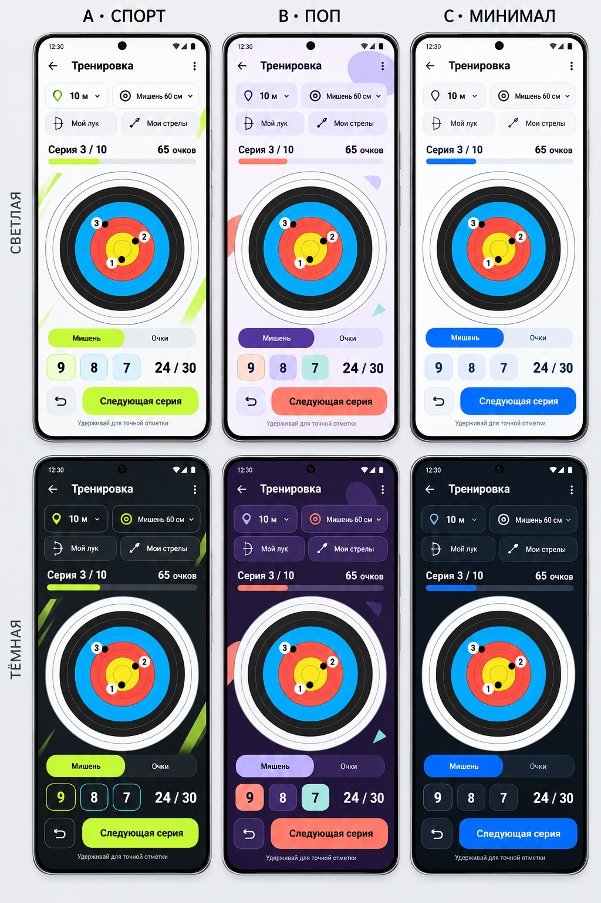

# Выбор визуального направления

Статус: пользователь выбрал все три направления с переключением в настройках. По умолчанию — Спорт. Каждое направление поддерживает светлую и тёмную темы.

## Как читать макет

Три столбца: A — спорт, B — поп, C — минимал. Верхний ряд — светлая тема, нижний — тёмная. На всех экранах один сценарий: активная тренировка, выбранные дистанция/мишень/лук/стрелы, текущая серия, отметки на мишени, переключатель способа ввода и переход к следующей серии.

Данные демонстрационные. Изображение задаёт визуальный ориентир. Геометрия мишени, соответствие отметок очкам, контраст, размеры элементов и типографические параметры будут зафиксированы отдельно при подготовке спецификации.

## A — спорт

- Светлая тема: почти белая основа, тёмный текст, лаймовые основные действия, немного голубых акцентов.
- Тёмная тема: графитовая основа, контрастные лаймовые действия, сдержанные голубые детали.
- Характер: энергичный, собранный, выразительные крупные числа и уверенная типографика.
- Предложение по анимациям: короткое упругое появление отметки, плавное обновление числа очков, заполнение прогресса серии. На итоговом экране допустим краткий акцент при личном рекорде.

## B — поп

- Светлая тема: кремовая/сиреневая основа, фиолетовые и коралловые акценты, немного мяты.
- Тёмная тема: глубокая баклажановая основа с родственными акцентами.
- Характер: игривый, округлые формы, лёгкие графические украшения.
- Предложение по анимациям: небольшие пружинные реакции карточек и кнопок, появление достижений в стиле наклеек. Украшения не перекрывают мишень.

## C — минимал

- Светлая тема: белая основа, тёмный текст, насыщенный синий акцент.
- Тёмная тема: почти чёрная синеватая основа, мягко отделённые панели, синие действия.
- Характер: спокойный, точный, много визуального воздуха, тонкие иконки.
- Предложение по анимациям: короткие плавные переходы, небольшое перемещение и затухание, аккуратное изменение чисел.

## Общие предложения для дальнейшего согласования

- Цвета самой спортивной мишени сохраняются в обеих темах. Акцент приложения не меняет значение зон.
- Экран тренировки прежде всего помогает быстро вносить попадания одной рукой. Более выразительная графика возможна в итогах, истории и достижениях.
- Существенные действия имеют видимые кнопки; жесты ускоряют сценарии, но не скрывают необходимые возможности.
- Анимации сопровождают действие и не задерживают ввод следующего попадания. Предусмотреть уменьшение движения и отключение вибрации.
- Выбор стиля и светлого/тёмного режима описан в [правилах тем](theme-system.md). Рабочее значение режима при первом запуске — «Как в системе».
- Далее проработать главный экран, ввод попаданий, итог тренировки и общую статистику. Затем закрепить палитры, типографику, отступы, компоненты и правила движения всех трёх стилей.

## Генерация

Инструмент: встроенный `image_gen`, новая генерация без референса. Полный запрос сохранён в [comparison-prompt.txt](comparison-prompt.txt). Исходный результат скопирован в проект без изменения изображения. Версия: v1, 29 октября 2026.
