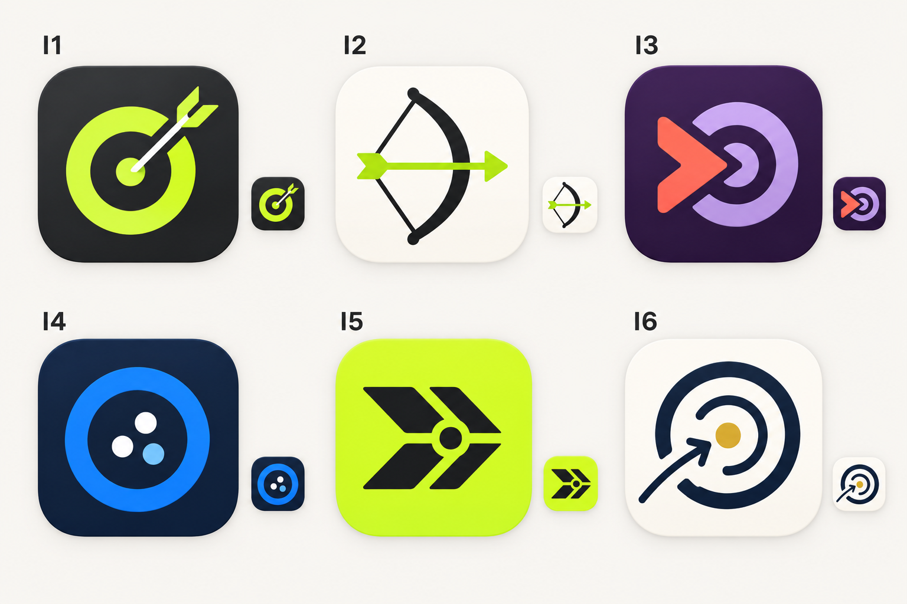

# Иконка: шесть направлений

Статус первого раунда: **пользователь выбрал I1** 29 октября 2026. После выбора имени FableShot она доработана в актуальный [вариант FS4](08-icon-refinement.md). Остальные варианты ниже сохранены как история. Изображение сгенерировано встроенным `image_gen`; [точный запрос](icon-prompt-v1.txt) сохранён. Это эскизы направления, не готовые адаптивные Android-ресурсы.

## I1. Стрела в центре — выбрано пользователем

Графит, лайм, крупная мишень и стрела. Узнаваемо и хорошо сочетается со Спортом по умолчанию. Сильная сторона — понятно назначение даже без названия. Что доработать: сделать знак менее типовым, упростить оперение и проверить монохромную версию.

## I2. Лук

Белый фон, чёрный геометрический лук и лаймовая стрела. Самая прямая ассоциация с видом спорта. Сильная сторона — спокойный характер для разных возрастов. Что доработать: толщина тетивы в маленьком размере, силуэт и отличие от обычной пиктограммы спорта.

## I3. Поп-мишень

Баклажановый, сиреневый и коралловый, округлая стрела и кольцо. Хорошо для «Лукбука» и выразительного бренда. Что доработать: не превратить силуэт в кнопку воспроизведения/перемотки, проверить узнаваемость без цвета.

## I4. Кучность

Синяя мишень с тремя близкими точками. Символ не одного идеального выстрела, а устойчивости. Хорошо сочетается с «Кучно». Что доработать: избежать ассоциации с боулингом/меню из точек; можно расположить точки как реальные отметки на кольце.

## I5. Оперение

Лаймовый фон и чёрный угловатый знак. Самый заметный в сетке приложений, удобно анимировать линии. Что доработать: усилить связь с оперением стрелы, чтобы не читалось как общий логотип доставки/навигации.

## I6. Движение к центру — спокойный фаворит

Светлая основа, тёмные незамкнутые кольца и золотая точка. Подходит имени «До центра» и более универсальному характеру. Что доработать: убрать лишнюю детализацию в маленьком варианте и найти собственную геометрию стрелки.

## Возможные связки, предложенные до выбора I1

- «До центра» + I6: рост, спокойствие, путь к точности.
- «Кучно» + I4: наблюдения и стабильная группа.
- «Тетива» + I2: ясный спортивный инструмент.
- Любое выбранное имя + I1: сильный спортивный образ по умолчанию.

Название и знак не обязаны буквально изображать друг друга. Можно выбрать силуэт одного варианта и цветовое настроение другого.

## Требования к финальной иконке

- Один узнаваемый знак приложения, сохраняющийся при смене оформления внутри него. Альтернативные иконки не добавляем автоматически только из-за выбора Поп/Минимал.
- Читаемость в маленьком размере, в круглом/скруглённом/другом launcher-маскировании и в монохроме.
- Финальная реализация предпочтительно в векторе, отдельные foreground/background и monochrome-слои. По [рекомендации Android](https://developer.android.com/develop/ui/compose/system/icon_design_adaptive) слои 108 × 108 dp; основное изображение удерживается в центральной безопасной области 66 × 66 dp. Тени и скруглённая маска из контактного листа не запекаются в исходный знак.
- Отдельно подготовить изображение для магазина после проверки его действующих требований. Сгенерированный лист целиком не становится иконкой APK.
- Форма важнее мелких надписей; без имени приложения внутри маленького знака.

## Что дальше

Доработка под имя FableShot выполнена: пользователь выбрал [FS4 — стрелу-перо](08-icon-refinement.md). Использовать её в новых материалах; I1 остаётся историей. Далее проверить маленький размер/монохром и подготовить адаптивные слои Android и изображение магазина.
