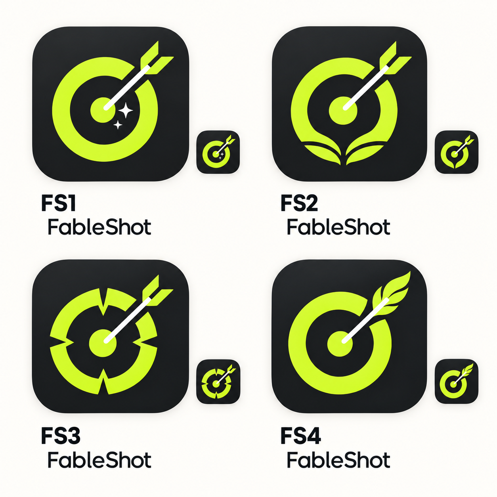

# Доработка иконки под FableShot — выбран FS4

Статус: решено пользователем 29 октября 2026. После выбора имени FableShot пользователь предложил доработать исходную I1 и выбрал четвёртый вариант нового листа. Материалы сразу сохранены в решённые вопросы, без добавления закрытой темы в активный список.

## Актуальный знак

**FS4: мишень со стрелой-пером.** Графитовая основа, толстое лаймовое разомкнутое кольцо и центральная точка, белое диагональное древко, лаймовое оперение с образом пера. Соединяет Shot — попадание — и Fable — личную историю/легенду. Это самостоятельный знак FableShot, без отсылки к конкретному персонажу.

Цветной PNG подготовлен отдельным квадратным изображением без подписей, миниатюр и внешнего белого фона. Это визуальный мастер для разработки; foreground/background/monochrome-слои Android и проверка масок готовятся при подготовке ресурсов приложения.

## Варианты, из которых сделан выбор

- **FS1:** сохранён исходный знак и добавлены две искры рядом с попаданием — наиболее деликатная доработка.
- **FS2:** нижняя часть кольца напоминает разворот книги — более буквальная связь с историей.
- **FS3:** угловатые прорези кольца создают геометрический знак следопыта.
- **FS4 — выбран:** оперение превращено в выразительное перо; мишень и стрела остаются главными элементами.

Все четыре варианта происходят от I1 и сохраняют её графитово-лаймовый характер. Выбор FS4 заменяет I1 как текущую финальную визуальную версию, не отменяя исходного направления.

## Правила дальнейшего использования

- В новых макетах и материалах использовать FS4. I1 — исторический эскиз, а не конкурирующий актуальный вариант.
- Один знак для всех трёх стилей и светлого/тёмного режима приложения. Название — FableShot, точное написание сохранено.
- Не добавлять в маленькую иконку надпись, звёзды FS1, книгу FS2 или прорези FS3 без нового решения пользователя.
- Для адаптивного ресурса сохранить всю форму пера внутри безопасной области. Декоративная launcher-маска не запекается в сам знак.
- Для монохромной версии проверить, что стрела и оперение остаются различимыми по геометрии, а не только за счёт белого/лаймового цвета.

## Источники и генерация

Оба изображения созданы встроенным `image_gen` по локальным референсам, без CLI/API-ключа.

- Первый референс: [исходный лист I1–I6](icon-directions-v1.png), использовалась только I1.
- [Полный запрос сравнительного листа](fableshot-icon-refinements-v2-prompt.txt).
- Референс отдельного знака: нижний правый FS4 на новом листе.
- [Полный запрос отдельного мастер-изображения](fableshot-icon-fs4-master-prompt.txt).

Ни исходный лист, ни результаты предыдущих раундов не перезаписаны. Следующее действие по бренду — подготовка производственных ресурсов, повторный выбор варианта не требуется.
